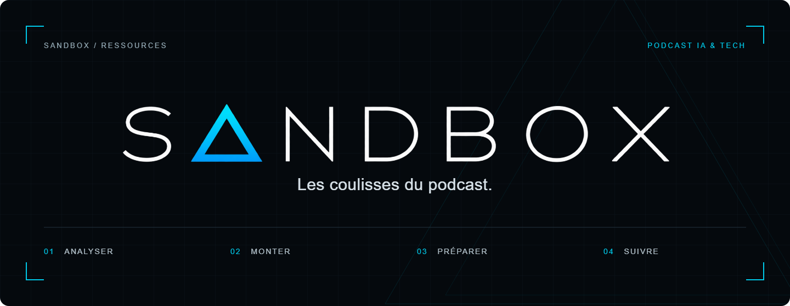

<div align="center">



# Les coulisses de SANDBOX

Les ressources et les outils avec lesquels nous préparons le podcast.<br>
Du master vidéo aux extraits, jusqu'aux kits de diffusion et au suivi des résultats.

[](https://github.com/Sandbox-podcast/sandbox-podcast-resources/actions/workflows/ci.yml)
[](https://github.com/Sandbox-podcast/sandbox-podcast-resources/actions/workflows/youtube-growth.yml)
[](docs/factory/README.md)

[Le podcast](https://www.sandboxpodcast.fr/) · [YouTube](https://www.youtube.com/@SandboxFR) · [La factory](#la-factory) · [Démarrer](#démarrer-en-local) · [Les skills](#les-skills) · [Contribuer](#contribuer)

</div>

SANDBOX est un talkshow français sur les effets de l'IA sur le développement logiciel, les produits numériques et les équipes tech. Lou, Nicolas et Loïc y testent des outils, construisent des projets et confrontent leurs points de vue.

Ce dépôt rassemble le travail de production : identité visuelle, médias, montages et outils. Le code du site, les contenus publiés et les décisions de conception se trouvent dans [sandbox-podcast-site](https://github.com/Sandbox-podcast/sandbox-podcast-site).

## Par où commencer

<table>
<tr>
<td width="50%" valign="top">

### Préparer une émission

Les fichiers à fournir, le parcours d'un épisode et les revues à réaliser avec l'équipe.

[Ouvrir le guide de la factory](docs/factory/README.md)

</td>
<td width="50%" valign="top">

### Lancer les outils

L'installation, le worker Windows, le tableau de bord et la reprise après interruption.

[Lire le guide d'exploitation](docs/factory/exploitation.md)

</td>
</tr>
<tr>
<td width="50%" valign="top">

### Produire des extraits

Les rendus verticaux pour les réseaux et les vidéos horizontales thématiques.

[Préparer les formats sociaux](tools/social-network-manager/GENERER.md) · [Produire une vidéo thématique](tools/youtube-growth/THEMATIC.md)

</td>
<td width="50%" valign="top">

### Retrouver les visuels

Les déclinaisons de l'identité SANDBOX pour la chaîne, le plateau et les réseaux.

[YouTube](assets/brand/youtube/README.md) · [Plateau OBS](assets/brand/obs/README.md) · [Réseaux sociaux](assets/brand/social/README.md)

</td>
</tr>
</table>

## La factory

Le nouveau parcours [`prepare`](docs/factory/autonomie-locale.md) part d'un master terminé et enchaîne transcription, sélection, extraits, contrôles automatiques, trois miniatures et calendrier prévisionnel avec des modèles locaux. Les comptes sociaux restent hors de ce parcours : aucun upload, brouillon ou programmation, même simulé.

La factory prépare les contenus issus d'une émission et conserve leur avancement dans une base locale. L'équipe examine les passages, les montages et leur présentation avant de préparer le calendrier.

1. **Analyser et sélectionner.** Repérer les sujets dans le master, conserver les timecodes et choisir les passages avec leur contexte et leurs réserves.
2. **Monter et contrôler.** Rendre les formats utiles, vérifier le cadrage, écouter les coupes et relire les sous-titres. Chaque revue porte sur une version précise du média.
3. **Préparer la diffusion.** Décliner les titres, miniatures et textes par réseau. Le calendrier commence après disponibilité confirmée de l'épisode et se termine avant le prochain tournage.
4. **Suivre les résultats.** Consigner les observations, les expériences et les décisions pour le cycle suivant. Les mesures absentes restent signalées.

Il n'y a aucun quota d'extraits à atteindre. Le programme exécute les traitements locaux ; l'analyse et la sélection demandent des preuves et un jugement éditorial.

> [!NOTE]
> La diffusion fonctionne en simulation. Aucun contenu ne part vers les comptes sociaux, y compris en privé, en brouillon ou en programmation. LinkedIn reçoit un pack à publier manuellement. Les données de démonstration sont synthétiques.

Les [capacités et leurs limites](docs/factory/capacites.md), la [procédure des miniatures](docs/factory/miniatures.md) et le [prompt maître du 28 octobre 2026](docs/factory/sources/prompt-maitre-2026-10-28.txt) précisent le fonctionnement attendu.

Le tableau local indique la prochaine étape et présente les passages avec leurs horaires, leurs raisons et un lien vers la vidéo. Les décisions de sélection et les demandes de montage se font dans le chat avec Codex. Le [guide pour l'équipe](docs/factory/README.md#lire-le-tableau-de-bord) explique ce parcours.

Le [guide d'optimisation](docs/factory/optimisation.md) décrit les calculs réutilisés, les mesures de ressources et le brief pour le prochain cycle. La commande `python -m youtube_growth.factory brief --episode-id IDENTIFIANT` rassemble les résultats disponibles et les points à réexaminer ; elle n'applique aucun changement automatique de stratégie.

## Démarrer en local

Prérequis : **Python 3.12+**, **FFmpeg** et **ffprobe** accessibles dans le `PATH`. Depuis la racine du dépôt, dans PowerShell :

```powershell
python -m venv .local/factory-venv
& ./.local/factory-venv/Scripts/python.exe -m pip install -r tools/youtube-growth/requirements.txt
$env:PYTHONPATH = 'tools/youtube-growth/src'

& ./.local/factory-venv/Scripts/python.exe -m youtube_growth.factory doctor
& ./.local/factory-venv/Scripts/python.exe -m youtube_growth.factory demo
& ./.local/factory-venv/Scripts/python.exe -m youtube_growth.factory --config .local/factory-demo/simulation-config.json --state-dir .local/factory-demo serve
```

Ouvre le tableau de bord sur [127.0.0.1:8765](http://127.0.0.1:8765). La démonstration crée ses médias et sa base sous `.local/factory-demo`, séparément du travail opérationnel. Aucun compte social ni clé API n'est nécessaire pour cette recette.

Pour traiter un épisode réel, installer le worker Windows ou sauvegarder l'état, suis le [guide d'exploitation](docs/factory/exploitation.md).

## Créer une nouvelle vidéo

Dans Codex ou Claude Code ouvert sur ce dépôt, écris « Je veux créer une nouvelle vidéo ». Le skill [`sandbox-video-onboarding`](.agents/skills/sandbox-video-onboarding/SKILL.md) demande le type de vidéo, le sujet ou te propose des pistes, puis le cadrage et la voix parmi celles de Voice Studio. Il enchaîne ensuite recherche, structure, rédaction, adaptation au narrateur, révisions française et orale, storyboard, montage, contrôles et exports, en chargeant à chaque étape les skills installés qui conviennent. Les réponses sont conservées pour reprendre plus tard. Le [guide de l'onboarding](docs/factory/onboarding-video.md) détaille le parcours.

## StoryTelling Generator

StoryTelling Generator transforme un sujet et ses sources en scénario, pistes sonores, plans et vidéo montée. Il conserve les versions dans la factory et permet de corriger une scène après l'export. Le parcours principal se pilote dans Codex, avec une interface locale pour retrouver chaque étape.

Dans un chat Codex ouvert sur ce dépôt, appelle le skill [`sandbox-storytelling-generator`](.agents/skills/sandbox-storytelling-generator/SKILL.md) :

```text
$sandbox-storytelling-generator
Crée une vidéo sur [mon sujet] à partir des fichiers joints.
Utilise ElevenLabs dans le navigateur intégré pour le son.
```

Pour ouvrir l'interface, écris `$sandbox-storytelling-generator Ouvre le générateur`. Le skill vérifie le serveur et le worker, puis ouvre la page ; cette demande seule ne lance aucune production. Pour reprendre, indique l'histoire à poursuivre ou la scène à corriger.

Tu peux aussi démarrer le serveur toi-même :

1. Installe les prérequis indiqués ci-dessus, puis lance le tableau de la factory :

   ```powershell
   $env:PYTHONPATH = 'tools/youtube-growth/src'
   & ./.local/factory-venv/Scripts/python.exe -m youtube_growth.factory serve --with-worker
   ```

2. Appelle le skill dans Codex avec ton sujet, tes sources et tes contraintes. Codex prépare le cadrage et te demande les choix déterminants qui manquent.
3. Ouvre [StoryTelling Generator](http://127.0.0.1:8765/storytelling). Tu peux y ajouter des notes, liens, documents et médias, choisir documentaire ou fiction, régler la durée et définir le plafond de crédits ElevenLabs. Le mode avec validation éditoriale s'arrête après le scénario et le storyboard.
4. Lance la production. Codex traite la requête de scénario et les demandes ElevenLabs depuis sa session active, puis les fichiers reçus sont importés dans le projet. Le worker mesure les voix, construit la timeline et rend la prévisualisation, le MP4 1080p et les sous-titres.
5. Relis et écoute le résultat. Pour corriger une scène, ouvre son texte, remplace une ressource ou régénère sa voix. Les ressources inchangées sont réutilisées ; une scène verrouillée protège aussi ses dépendances.

Le parcours ElevenLabs dans le navigateur nécessite une session Codex active. Un modèle local configuré peut assurer la rédaction dans le worker ; sans modèle, la requête reste à traiter par Codex. Les voix Windows et les médias autorisés permettent aussi un rendu local. L'API ElevenLabs serveur reste une option désactivée par défaut.

Le [tutoriel complet](docs/factory/storytelling-generator.md) détaille les sept étapes, la configuration, les commandes, les corrections et la reprise. Les tests techniques et les générations réellement effectuées sont distingués dans le [suivi de réalisation](docs/factory/storytelling-progress.md).

## Les skills

Un skill donne à l'agent (Codex ou Claude Code) les consignes d'une tâche précise. Le dépôt contient 10 skills SANDBOX et trois collections externes qui totalisent 199 entrées, choisies pour faire des vidéos YouTube sur l'IA.

### Skills SANDBOX

Dans Codex, appelle un skill avec `$nom-du-skill` ; dans Claude Code, avec `/nom-du-skill`. Pour une nouvelle vidéo, commence par `sandbox-video-onboarding`. Pour un épisode, `sandbox-factory` enchaîne les étapes ; pour une seule étape, appelle directement son skill.

| Skill | Usage |
| --- | --- |
| [sandbox-video-onboarding](.agents/skills/sandbox-video-onboarding/SKILL.md) | Point de départ d'une nouvelle vidéo sans brief complet. Demande type, sujet, cadrage et voix, puis conduit l'écriture, le storyboard, le montage et les exports. |
| [sandbox-storytelling-generator](.agents/skills/sandbox-storytelling-generator/SKILL.md) | Ouvre StoryTelling Generator, crée une vidéo narrative à partir d'un brief complet ou corrige une histoire existante : scénario, storyboard, voix et montage. |
| [sandbox-youtube-trend-hunter](.agents/skills/sandbox-youtube-trend-hunter/SKILL.md) | Propose des tendances Internet et YouTube sourcées, en général ou en IA et tech, puis exporte celle que tu choisis en brief pour StoryTelling Generator. |
| [sandbox-factory](.agents/skills/sandbox-factory/SKILL.md) | Lance, reprend ou diagnostique le cycle complet d'un épisode, du master aux rendus et au bilan. |
| [sandbox-analyse](.agents/skills/sandbox-analyse/SKILL.md) | Analyse le master ou la transcription d'un épisode, repère ses sujets et note ce qui a réellement été lu, écouté et regardé. |
| [sandbox-selection](.agents/skills/sandbox-selection/SKILL.md) | Choisit ou révise les extraits d'un épisode analysé : coupes, formats, passages retenus ou rejetés, réserves. |
| [sandbox-production](.agents/skills/sandbox-production/SKILL.md) | Monte et contrôle un rendu local à partir de coupes validées ou d'un scénario narratif sourcé, avec sous-titres et provenance. |
| [sandbox-packaging](.agents/skills/sandbox-packaging/SKILL.md) | Prépare titres, miniatures, couvertures et textes de diffusion, dont le pack LinkedIn à publier manuellement. |
| [sandbox-diffusion](.agents/skills/sandbox-diffusion/SKILL.md) | Planifie, suspend, reprend ou simule le calendrier entre la disponibilité de l'épisode et le prochain tournage. Rien n'est publié. |
| [sandbox-resultats](.agents/skills/sandbox-resultats/SKILL.md) | Collecte ou importe les performances, compare contenus et expériences, prépare le bilan et le brief du cycle suivant. |

Les consignes de référence sont dans `.agents/skills/`. Les fichiers de `.claude/skills/` y renvoient et se régénèrent avec `python tools/repository/sync_skills.py --write`.

### Skills externes

Les collections de [`.agents/vendor/`](.agents/vendor/README.md) sont copiées depuis une révision épinglée, avec leur licence. Ces skills ne s'appellent pas par leur nom : `sandbox-video-onboarding` choisit ceux de l'étape en cours et lit leur fichier. Pour en utiliser un en dehors de l'onboarding, donne son chemin à l'agent. Le [catalogue complet](.agents/vendor/CATALOGUE.md) liste les 199 entrées avec leur description d'origine.

Seuls les skills utiles pour des vidéos YouTube sur l'IA sont installés. Le [verrou](.agents/vendor/skills-lock.json) exclut le reste : presse écrite, newsletter, relations presse, radio, financement, séries télévisées, dramaturgies chinoise et japonaise, variantes en allemand, espagnol, italien et portugais. Les skills qu'utilise l'onboarding vidéo restent tous installés.

#### humaniseur-fr

[humaniseur-fr](.agents/vendor/cc-skills/skills/humaniseur-fr/SKILL.md), tiré de [samber/cc-skills](https://github.com/samber/cc-skills), retire d'un texte français les tournures typiques d'une IA et lui redonne une voix. Il repère 38 motifs, dont le vocabulaire convenu (« crucial », « notamment »), les anglicismes (« faire du sens ») et les ouvertures toutes faites (« À l'ère de »). Ses consignes sont en anglais.

#### screenwriting-skills

7 skills d'écriture de récit et de scénario, issus de [jtydhr88/screenwriting-skills](https://github.com/jtydhr88/screenwriting-skills). Leurs consignes sont en chinois ; l'agent répond dans la langue de la demande. Leur [table de termes](.agents/vendor/screenwriting-skills/skills/sw-workflow/terms.md) donne les équivalents d'origine.

| Skill | Usage |
| --- | --- |
| [sw-character-conflict](.agents/vendor/screenwriting-skills/skills/sw-character-conflict/SKILL.md) | Construire les personnages, le duo protagoniste et antagoniste, et le conflit dramatique. |
| [sw-dialogue](.agents/vendor/screenwriting-skills/skills/sw-dialogue/SKILL.md) | Écrire et réviser les dialogues : dialogue comme action, non-dit, sous-texte, voix de chaque personnage. |
| [sw-genre-anatomy](.agents/vendor/screenwriting-skills/skills/sw-genre-anatomy/SKILL.md) | Anatomie des genres selon John Truby : les étapes propres à chaque genre, leur mélange et leur dépassement. |
| [sw-premise-theme](.agents/vendor/screenwriting-skills/skills/sw-premise-theme/SKILL.md) | Prémisse, thème, idée directrice, choix du sujet et logline. |
| [sw-scene-craft](.agents/vendor/screenwriting-skills/skills/sw-scene-craft/SKILL.md) | Construire scènes et séquences : retournements, battements, sous-texte, rythme et suspense. |
| [sw-story-structure](.agents/vendor/screenwriting-skills/skills/sw-story-structure/SKILL.md) | Structure du récit : Syd Field, *Save the Cat*, McKee. |
| [sw-truby-anatomy](.agents/vendor/screenwriting-skills/skills/sw-truby-anatomy/SKILL.md) | Anatomie du récit selon Truby : principe de conception, sept étapes clés, vingt-deux étapes et enjeu moral. |

#### autopunk-media-skills

182 skills, 7 variantes françaises et 2 agents, issus de [ur-grue/autopunk-media-skills](https://github.com/ur-grue/autopunk-media-skills). Leurs consignes sont en anglais. Le catalogue complet donne chaque skill et sa description ; voici les familles :

| Famille | Skills | Contenu |
| --- | ---: | --- |
| [research](.agents/vendor/autopunk-media-skills/skills/research/) | 45 | Contexte et faits, vérification, chiffres, articles scientifiques, personnalités, veille des concurrents et des tendances. |
| [writing](.agents/vendor/autopunk-media-skills/skills/writing/) | 18 | Voix off et prompteur, accroches d'ouverture, titres, descriptions et chapitres YouTube, réécriture plus claire ou plus courte. |
| [tv-documentary](.agents/vendor/autopunk-media-skills/skills/tv-documentary/) | 15 | Commentaire et narration, script d'explication animée, découpage des séquences, notes de montage, sous-titres. |
| [youtube](.agents/vendor/autopunk-media-skills/skills/youtube/) | 15 | Idées de vidéos, accroches, scripts, Shorts, titres SEO, miniatures, chapitres, analyse et calendrier de la chaîne. |
| [editing](.agents/vendor/autopunk-media-skills/skills/editing/) | 11 | Correction, relecture, structure, cohérence du ton et des termes, affirmations sans source, risque de diffamation. |
| [image-prompting](.agents/vendor/autopunk-media-skills/skills/image-prompting/) | 10 | Prompts d'images pour Midjourney et Flux, direction artistique, planches d'ambiance, séries de visuels. |
| [data-journalism](.agents/vendor/autopunk-media-skills/skills/data-journalism/) | 9 | Analyse de données, explication des statistiques, choix et légendes de graphiques, infographies. |
| [magazine-journalism](.agents/vendor/autopunk-media-skills/skills/magazine-journalism/) | 9 | Angles, vérification des sources et des chiffres, repérage du jargon, condensation d'un texte. |
| [podcast](.agents/vendor/autopunk-media-skills/skills/podcast/) | 9 | Concepts d'épisode, recherche sur l'invité, questions, intro et outro, lectures sponsorisées, notes d'épisode. |
| [screenwriting](.agents/vendor/autopunk-media-skills/skills/screenwriting/) | 9 | Logline, traitement, séquencier, scènes, personnages, dialogues et notes de lecture. |
| [social-media](.agents/vendor/autopunk-media-skills/skills/social-media/) | 9 | Formats courts, légendes, carrousels, threads, hashtags et stratégie par plateforme. |
| [audience-distribution](.agents/vendor/autopunk-media-skills/skills/audience-distribution/) | 7 | Public cible, moment de publication, choix des plateformes, variantes A/B, analyse des commentaires. |
| [media-business](.agents/vendor/autopunk-media-skills/skills/media-business/) | 5 | Droits : ayants droit, Creative Commons, licences, autorisations des personnes filmées. |
| [pre-production](.agents/vendor/autopunk-media-skills/skills/pre-production/) | 5 | Fiche de faits, glossaire du sujet, questions d'interview, plan de tournage. |
| [archive-legal](.agents/vendor/autopunk-media-skills/skills/archive-legal/) | 3 | Droits des images et de la musique, risque juridique. |
| [production-support](.agents/vendor/autopunk-media-skills/skills/production-support/), [radio-audio](.agents/vendor/autopunk-media-skills/skills/radio-audio/) et [translation-localization](.agents/vendor/autopunk-media-skills/skills/translation-localization/) | 3 | Mise en forme d'une transcription, narration documentaire pour l'écoute, traduction de sous-titres. |

Les [7 variantes françaises](.agents/vendor/autopunk-media-skills/skills/locales/fr/) adaptent des skills courants : accroches, titres SEO, angles, logline, questions d'interview, notes d'épisode et légendes.

Les 2 agents enchaînent plusieurs skills pour livrer un ensemble complet :

| Agent | Livrable |
| --- | --- |
| [youtube-channel-operator-agent](.agents/vendor/autopunk-media-skills/agents/youtube-channel-operator-agent.md) | Une vidéo YouTube : script, titres, brief de miniature, description SEO et chapitres. |
| [podcast-producer-agent](.agents/vendor/autopunk-media-skills/agents/podcast-producer-agent.md) | Un épisode de podcast prêt à enregistrer, du concept aux notes et descriptions d'épisode. |

## Dans le dépôt

GitHub contient le code, les projets éditables et la documentation. Les masters, Shorts, vidéos, miniatures, sous-titres et packs générés restent sur l'ordinateur de la personne qui utilise la factory. Les workflows vérifient les sources et ne publient aucun média de production en artefact GitHub.

| Emplacement | Ce que tu y trouves |
| --- | --- |
| [assets/brand/](assets/brand/) | Logo commun, gabarits SVG et consignes de l'identité SANDBOX. |
| [projects/](projects/) | Sources éditables des vidéos, jingles, expériences et kits. |
| [tools/](tools/) | Outils de production, de croissance YouTube et de gestion des réseaux sociaux. |
| [docs/factory/](docs/factory/) | Guides de la factory, diagnostics et rapports de validation. |
| [.agents/skills/](.agents/skills/) | Skills SANDBOX, de l'onboarding vidéo au bilan ; voir [la liste](#les-skills). |
| [.agents/vendor/](.agents/vendor/) | Collections de skills externes épinglées, avec licences et [catalogue](.agents/vendor/CATALOGUE.md), chargées par l'onboarding vidéo. |
| [config/factory.json](config/factory.json) | Configuration versionnée de la factory. |
| [docs/site/history/](docs/site/history/) | Rapports datés du site, classés par année et mois. |
| [archive/platform/](archive/platform/) | Code de l'ancienne plateforme, conservé pour référence. |

La factory écrit sa base, ses analyses et ses rendus dans `.local/factory/`, ignoré par Git. Les anciens livrables de ce poste sont conservés dans `.local/legacy/`. Sur un autre ordinateur, chaque personne fournit ses propres médias. Un nouveau rendu ne remplace jamais le master.

Le [guide d'organisation](docs/organisation.md) décrit le rangement local et la migration des anciens dossiers. Un contrôle de la CI refuse les médias ajoutés à Git, même avec un ajout forcé. Le logo commun et l'illustration de ce README sont les deux images partagées autorisées.

## Contribuer

Chaque nouveau prompt de travail envoyé à un harnais d'agent doit avoir son issue GitHub. L'agent y consigne la demande et l'avancement, puis la relie à chaque PR correspondante. **L'issue reste ouverte jusqu'à la fusion de la PR qui termine le travail.** Une PR en attente, fermée sans fusion ou bloquée laisse donc le sujet visible.

Les règles complètes sont dans [AGENTS.md](AGENTS.md). Les [issues ouvertes](https://github.com/Sandbox-podcast/sandbox-podcast-resources/issues) montrent les sujets en cours. Un [modèle de demande](https://github.com/Sandbox-podcast/sandbox-podcast-resources/issues/new?template=prompt-agent.yml) et un [modèle de PR](.github/pull_request_template.md) reprennent ce suivi.

<details>
<summary><strong>Commandes de contrôle</strong></summary>

Pour les outils Python et la factory, depuis la racine :

```powershell
$env:PYTHONPATH = 'tools/youtube-growth/src'
python -m unittest discover -s tools/youtube-growth/tests -v
```

La recette audiovisuelle explicite utilise `FACTORY_MEDIA_INTEGRATION=1`. Les tests ordinaires ne prouvent ni une revue audiovisuelle ni une validation avec un compte réel.

Pour le projet Remotion `projects/videos/sandbox-intro` :

```powershell
npm ci --prefix projects/videos/sandbox-intro
npm test --prefix projects/videos/sandbox-intro
```

Les workflows [Resource checks](.github/workflows/ci.yml) et [YouTube SANDBOX](.github/workflows/youtube-growth.yml) détaillent les autres contrôles des pipelines et projets vidéo.

</details>

<details>
<summary><strong>Origine du dépôt et lien avec le site</strong></summary>

Le premier instantané de séparation vient de `sandbox-podcast-site` à la révision `63385fe20fe04ce2429e027c23d94ba3b089bf4c`. L'historique antérieur reste consultable dans [ce dépôt source](https://github.com/Sandbox-podcast/sandbox-podcast-site).

L'expérience de l'épisode 002 bis conserve un instantané textuel du lecteur à la date de séparation. Son export écrit désormais dans `.local/decks/episode-002-bis` ; il ne copie plus de médias dans le dépôt du site.

Les [sources du visuel de ce README](docs/readme/README.md) comprennent la commande de génération et la provenance du logo.

</details>
